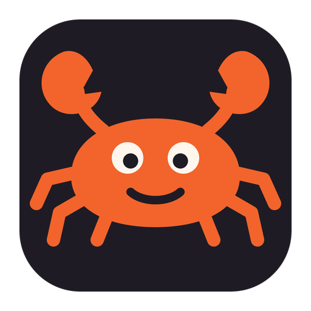
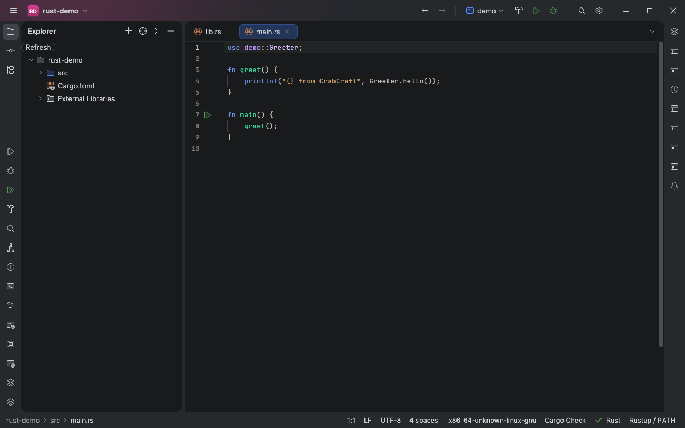
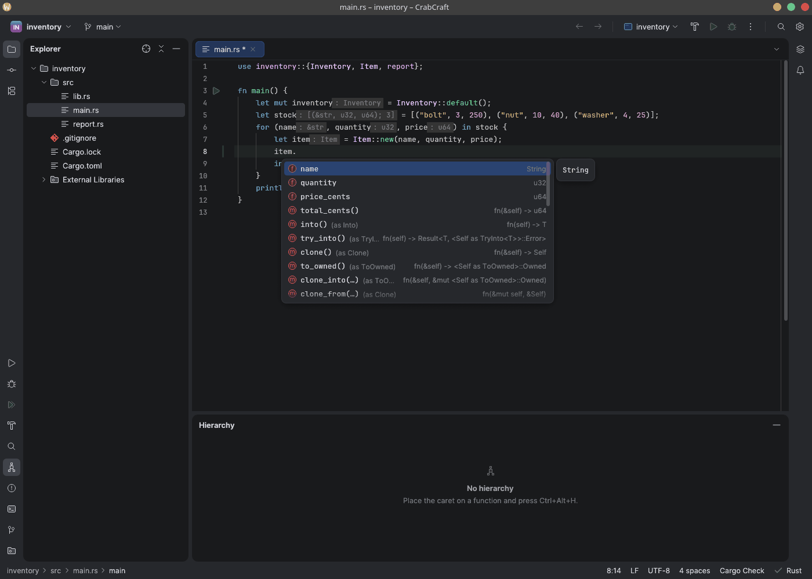
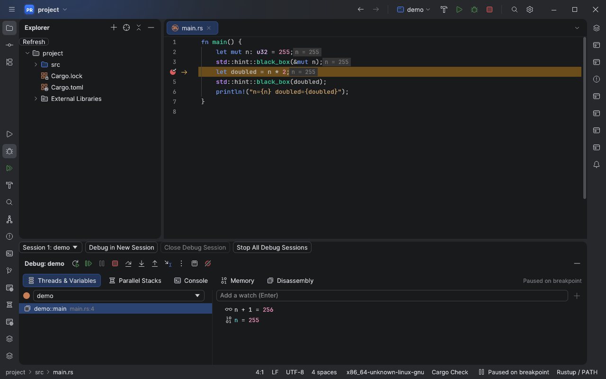
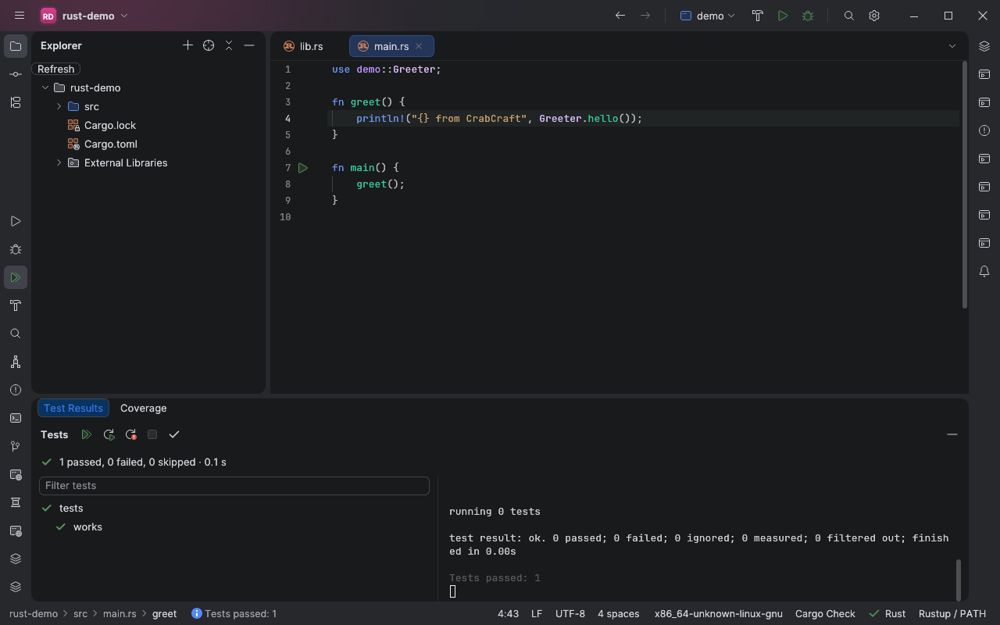
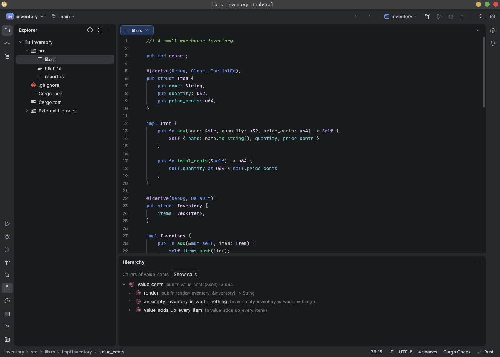

<p align="center">
  
</p>

<h1 align="center">CrabCraft</h1>

<p align="center">
  <strong>A lightweight, native IDE for Rust.</strong><br>
  A single fast desktop binary built with Rust and egui.
</p>

<p align="center">
  <a href="https://github.com/RafaelMendes1407/CrabCraft/releases/latest"></a>
  <a href="https://github.com/RafaelMendes1407/CrabCraft/releases/latest"></a>
  <a href="https://github.com/RafaelMendes1407/CrabCraft/releases/latest"></a>
</p>



> **Status: early preview.** The core workflow works on real Rust projects, but expect rough edges
> and missing features. CrabCraft started as a port of
> [DotCraft](https://github.com/javy-fernandez/dotcraft), a native .NET IDE, and some inherited
> code has not been verified with Rust yet. [FEATURES.md](FEATURES.md) tracks every planned
> feature and its real status, in Portuguese.

CrabCraft takes its layout from the JetBrains New UI, and uses
[rust-analyzer](https://rust-analyzer.github.io/) for code intelligence and tree-sitter for syntax.
It is an independent project and has not been compared feature by feature with RustRover.

## Install

Download the latest build from the [releases page](https://github.com/RafaelMendes1407/CrabCraft/releases/latest):

| Platform | File | How to use it |
| --- | --- | --- |
| Windows x64 | `CrabCraft-<version>-setup.exe` | Run the installer. |
| Windows x64 | `CrabCraft-<version>-windows-x64.zip` | Unzip it and run `CrabCraft.exe`. |
| Linux x86_64 | `CrabCraft-<version>-linux-x86_64.tar.gz` | Unpack it, then run `./install.sh` or `./crabcraft`. |

The builds are not code-signed, so Windows SmartScreen may warn. `SHA256SUMS.txt` lists the
checksums. The Windows build compiles but has not been used on a real Windows machine yet, so
reports are welcome.

### What you also need

- A Rust toolchain from [rustup](https://rustup.rs/), with rust-analyzer:
  `rustup component add rust-analyzer`
- Git on `PATH`, for the Git features.
- GDB 14 or later on `PATH`, for debugging. Debugging has only been tested on Linux.
- Linux needs glibc 2.35+ and Vulkan or OpenGL ES, on X11 or Wayland. Windows needs Windows 10/11.

### Trust the project first

Opening a project never runs its code. Code insight starts after you click **Trust this project**
in the status bar, because rust-analyzer runs build scripts and procedural macros. Until then there
is no completion, navigation or error checking.

## Features

### Code insight



Completion with documentation and auto-import, go to definition, find usages, rename, Refactor This
(`Ctrl+Alt+Shift+T`), quick fixes, inlay hints and Optimize Imports, all powered by rust-analyzer.

### Debugging



Debug with GDB: breakpoints, conditions, logpoints, stepping that skips the standard library,
variables, watches and values shown inline.

### Tests and Cargo



Run binaries, tests and benchmarks from the gutter, see the results in a tree, and apply
compiler suggestions from the build output. Run Anything takes any Cargo command.

### Navigation



Call and type hierarchies, Search Everywhere (double `Shift`), breadcrumbs, bookmarks and Select In
(`Alt+F1`).

### Also included

Tree-sitter syntax, multiple carets, folding, an integrated terminal, Git changes, diff, blame and
commit, and an interface in eight languages.

## Build from source

CrabCraft needs Rust 1.90 or later (edition 2024).

```bash
cargo run --release -p rc-app
```

Linux also needs `libxkbcommon-dev` and `libwayland-dev`.

Run the tests that need no external tools:

```bash
cargo test -p rc-app -p rc-text -p rc-syntax -p rc-core -p rc-cargo --lib
```

## Architecture

CrabCraft is a Cargo workspace; each crate has one job. See
[docs/architecture.md](docs/architecture.md) and [docs/performance.md](docs/performance.md).

## Credits and license

CrabCraft is based on [DotCraft](https://github.com/javy-fernandez/dotcraft) by javy-fernandez and
the DotCraft contributors, and keeps its Git history.

Licensed under either of [Apache License, Version 2.0](LICENSE-APACHE) or [MIT license](LICENSE-MIT)
at your option.

Icons in `assets/icons` come from the [IntelliJ Platform](https://github.com/JetBrains/intellij-community)
(Apache 2.0) and, for the Rust and Cargo file icons, the
[IntelliJ Rust plugin](https://github.com/intellij-rust/intellij-rust) (MIT); see [assets/icons/NOTICE.md](assets/icons/NOTICE.md). CrabCraft is not affiliated with
JetBrains, the Rust Foundation or Microsoft.
