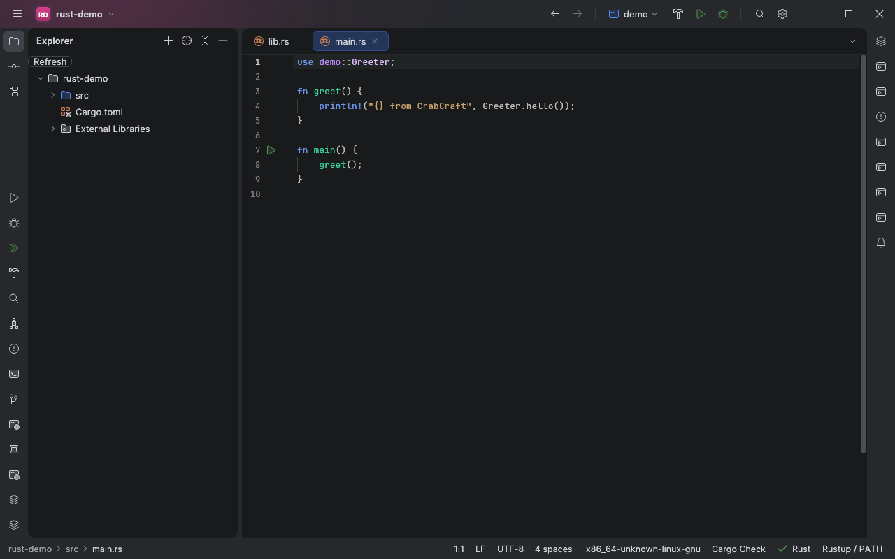
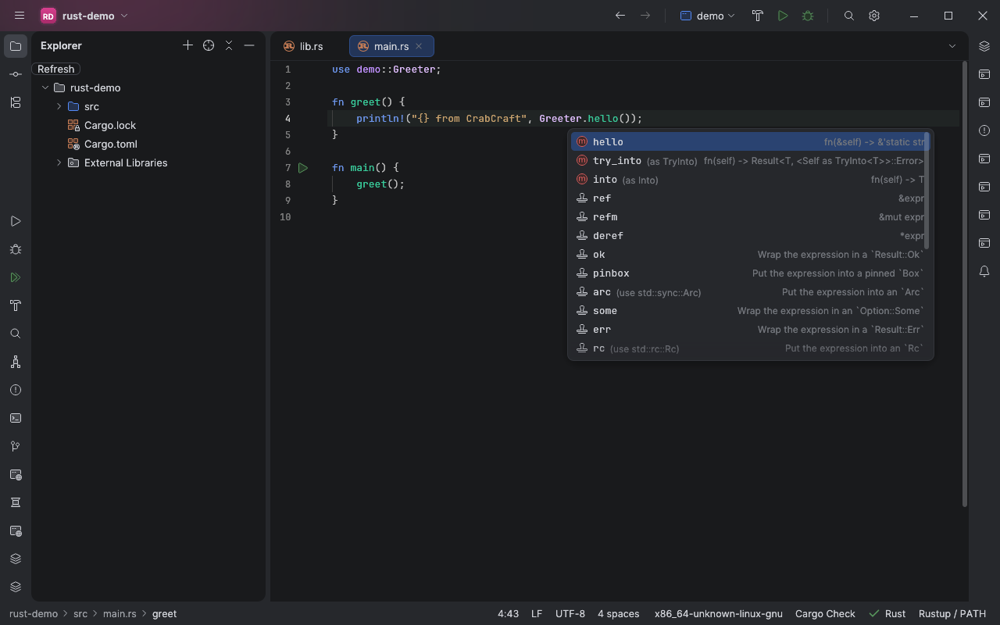
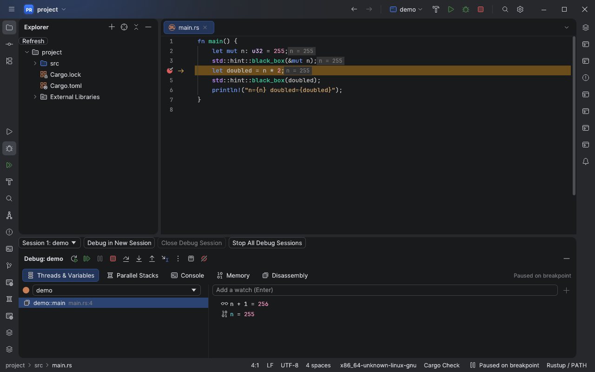

# Main feature guide

CrabCraft combines a native Rust editor with Cargo, rust-analyzer, Git and external debugger
adapters. This guide explains the everyday workflows. The [feature inventory](../FEATURES.md)
records exact statuses and evidence; the linked specialist guides describe narrower limits.
Start with [your first project](getting-started.md) if you have not opened a workspace yet.

## Workspace and toolchains

Open a Cargo root to load its packages and targets after granting project trust. A workspace
keeps related packages together, while attached Cargo projects let you work with additional
roots. Use the Cargo tool window to inspect the loaded model and available targets.
Project environment variables apply to Cargo and rust-analyzer; run-configuration values
take precedence for that configuration.

Rustup is the ordinary toolchain provider. Configure tools in Settings → Tools and use
the target selector when analyzing code for another target. Selecting an analysis target
does not install its standard library. Ferrocene/CriticalUp is a separate partial provider
with explicitly unsupported workflows; see [its scope](criticalup-provider.md).

## Editing, saving and recovery

The editor provides Rust syntax highlighting, folding, paired delimiters, line/block
comments and multiple cursors. In Settings → Editor, choose font and display preferences;
the application supports light and dark themes. Tabs can be split or moved to arrange
related files side by side.

Use **Reformat Code** to run rustfmt with your configured arguments, channel and environment.
Formatting a selection applies changed blocks touching the selected lines; a block crossing
the boundary is applied as a whole. Project rustfmt configuration belongs in the project's
`rustfmt.toml`; CrabCraft's own repository config does not impose a style on other projects.

Saving and formatting run in the background. Operations depending on saved files wait for
the save queue. Optional idle autosave defaults to a five-second delay and does not run
rustfmt. **Show Local History** lists retained saved/reloaded versions; reverting a version
creates an undoable buffer edit. History is local recovery, not a substitute for Git or backups.

Opening a standalone file uses LightEdit without a project language server. Large files
above 8 MiB open read-only; files above 128 MiB are refused. Read
[document I/O](document-io.md), [background saving](background-saving.md),
[reverting](revert-from-disk.md) and [workspace restoration](workspace-restoration.md).

## Code insight and refactoring

After trust, rust-analyzer supplies completion, documentation, auto-import suggestions,
definition navigation, usages, rename, diagnostics and context actions. Use a context action
to inspect an available fix, or **Refactor This** to find applicable refactorings.
Compiler diagnostics and inlay hints help explain types and errors while you edit.

Semantic operations depend on the server's response and the loaded Cargo model. Review edits,
especially multi-file changes. [Change Signature](change-signature.md) and
[Move Items](moving-items.md) document their supported forms and refusal cases.
[Macro expansion](macro-one-step.md) and the [declarative macro tester](macro-tester.md)
serve different purposes: inspecting expansion versus trying a macro against sample input.

## Search and navigation

Use **Search Everywhere** for project navigation, **Find Action** for commands and
**Find in Files** for text searches with case, word, regex, mask and scope controls.
Call and [type hierarchies](type-hierarchy.md) explain relationships between symbols;
recent files, bookmarks and breadcrumbs help revisit locations.

Review the complete result set before **Replace All**. Open buffers receive undoable edits
and remain unsaved; closed files are written to disk. Cancellation keeps replacements
already completed, so replacement is not a workspace-wide transaction. Truncated or cancelled
searches cannot be used for Replace All. See [search and replacement](find-replace.md).

## Build, run and test

**Build Project** invokes Cargo and reports its output. Select a Cargo target through a run
configuration or use an available gutter action to run a binary, test or benchmark.
Run configurations keep arguments, environment and working-directory choices together.
**Run Anything…** accepts Cargo commands; it requires the same project trust as other
execution actions. Cancellation stops the active operation rather than blocking the editor.

Tests appear in a result tree with success/failure markers and source navigation. Rerun failed
tests to focus on a regression. Cargo runs doctests; the optional cargo-nextest integration
must be installed separately and does not include doctests. Benchmark gutter actions use
`cargo bench`; they are not debugger launches.

For line coverage, install cargo-llvm-cov and the llvm-tools-preview component and use the Coverage tab in Tests. You can also import
an LCOV report without running the project. Coverage does not claim branch/function coverage,
and imported suites are session-local. See [coverage](coverage.md).
Other explicit tool integrations include [evcxr REPL](repl-variables.md) and
[wasm-pack](wasm-pack.md); tools are not installed automatically.

## Debugging

Choose GDB or LLVM LLDB DAP in Settings → Tools, select a run configuration, set a source
breakpoint and choose **Debug**. At a stop, use frames, variables and watches to inspect the
program, then step, resume or run to the cursor. Conditions and logpoints depend on adapter
capabilities. The debugger is an external process and requires a trusted workspace.

**Debug in New Session** keeps another session alive. The session selector changes which
frames, watches and execution marker you see; **Stop** affects the selected session and
**Stop All Debug Sessions** ends them all. Sessions are not restored after restarting the IDE.
See [adapter setup](rust-debuggers.md), [parallel sessions](debug-sessions.md),
[parallel stacks](parallel-stacks.md) and [remote debugging](remote-debugging.md).
Administrator debugging remains partial, with [separate limits](administrator-debugging.md).

## Cargo dependencies

From Cargo, open **Manage Cargo Dependencies…** and select a workspace package. Inspect its
dependencies, enter a crate/version or explicitly search crates.io, then add/update/remove
the dependency. The manager supports normal, development and build dependencies, local paths
and feature options. Save manifest editors first; changes require project trust.

Offline mode affects Cargo operations; a crates.io search is a separate network action.
Advanced workspace, target-specific and registry configuration still belongs in Cargo.toml.
See [dependency management](cargo-dependencies.md) and [missing crates](missing-crates.md).

## Git and terminal

After trust, use Git to inspect changes and diffs, stage work and commit. Branches, history,
blame, stashes, tags and worktrees support everyday repository work. Review the selected
changes before a write operation. [Shelves](shelves.md) retain selected local changes;
[history editing](history-editing.md) covers operations that change commits.
Git operations use your separately installed Git and credentials.

Open Terminal explicitly to start a shell in the workspace. Tabs keep independent shells;
horizontal/vertical splits display two sessions together. Closing a tab terminates its shell,
and sessions are not reopened after restarting CrabCraft. Terminal search is literal and
case-sensitive. See [terminal behavior](terminal.md) and [completion](terminal-completion.md).

## Optional integrations

| Workflow | What it provides | Read before use |
| --- | --- | --- |
| Web assets | HTML/CSS/JS/TS syntax and explicitly configured language servers alongside Rust | [Web languages](web-languages.md) |
| HTTP and Axum | Request files, environments and separate reviewed OAuth/script actions; semantic endpoint assistance | [HTTP](http-variables.md), [Axum](axum-endpoints.md) |
| Databases | Native SQLite/PostgreSQL queries and reviewed data import/export | [Database guide](database.md) |
| Local assistance | On-demand Ollama chat, ACP processes and local plugins | [Local AI](local-ai.md), [ACP](acp-agents.md), [plugins](local-plugins.md) |
| Remote workspace | A native Rust workspace using remote Cargo and rust-analyzer over SSH | [Remote development](remote-development.md) |
| File deployment | Reviewed SFTP and explicit FTPS transfers | [Deployment](deployment.md) |
| Containers and WSL | Implemented transports with remaining runtime/platform verification | [Docker](docker-tools.md), [Dev Containers](dev-containers.md), [WSL](wsl-workspace.md) |

These integrations have separate prerequisites and trust decisions. Their presence does not
mean CrabCraft bundles a database, model, container daemon or remote toolchain.

## Settings, accessibility and limits

Settings controls themes, fonts, keymaps and tool paths. Interface translations cover eight
languages. [Editor migration](editor-migration.md) previews portable settings imported from
other editors; it does not import executable commands, credentials or arbitrary plugins.
[Settings synchronization](settings-sync.md) has its own reviewed transfer scope.

Linux/X11 source-text and Project tree accessibility was verified with Orca/AT-SPI;
read [accessibility](accessibility.md) for the supported cases. Linux and Windows builds do
not establish equivalent interactive behavior on every platform. In particular, the repeated
Wayland resize fix has headless regression coverage and still needs real KDE/KWin verification.
Consult [troubleshooting](troubleshooting.md) and the inventory before relying on a partial feature.
